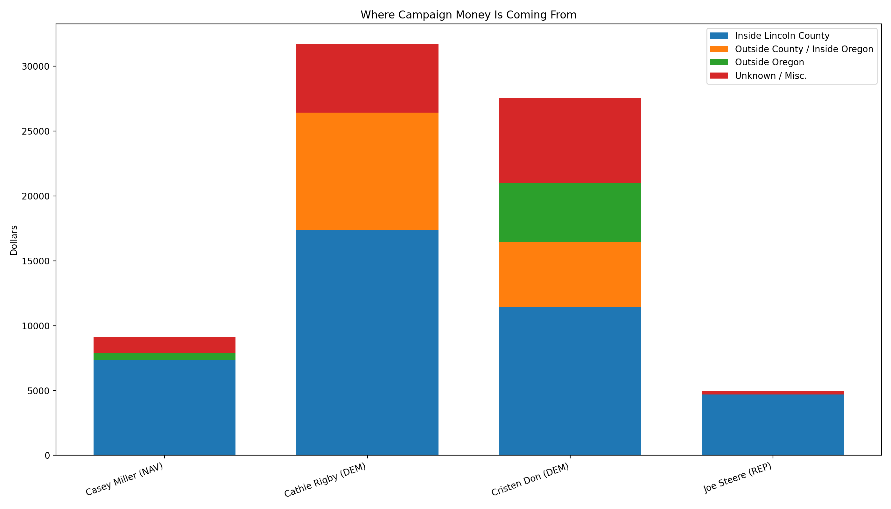
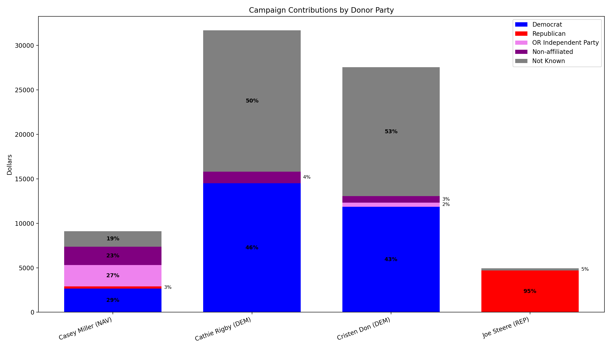
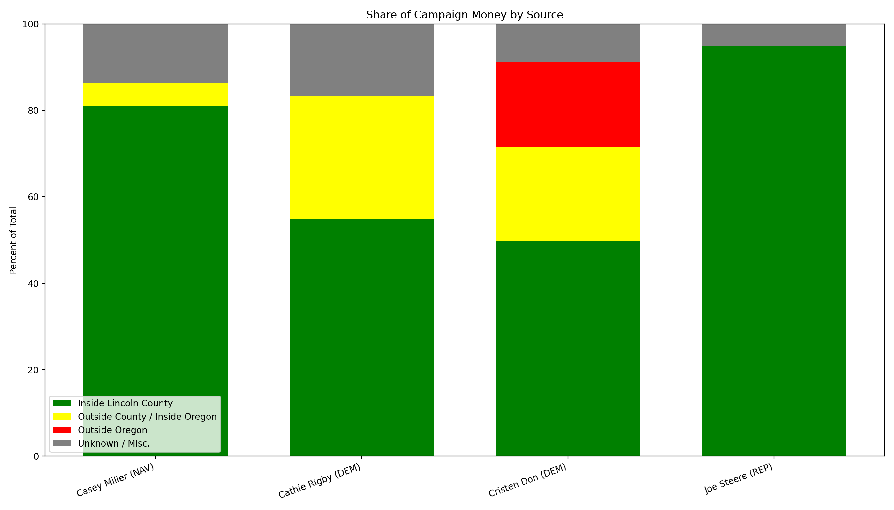
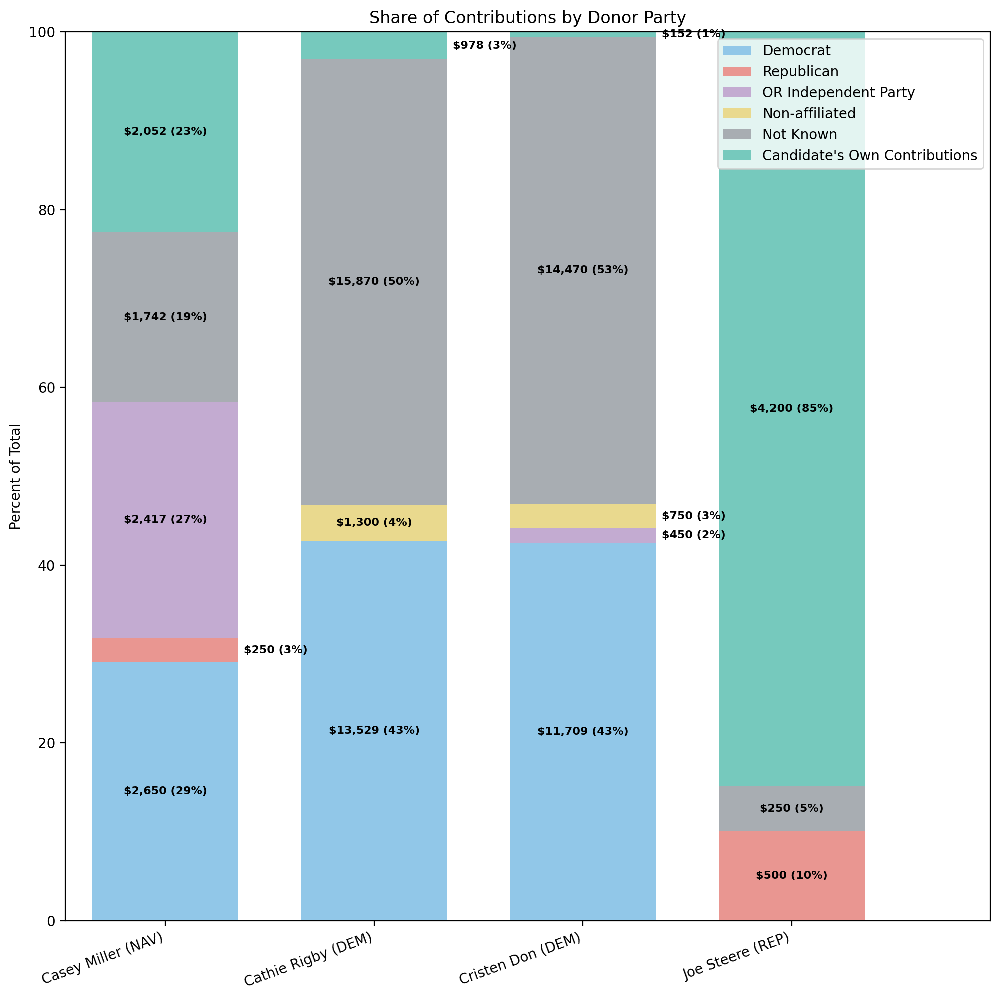

# ORESTAR Campaign Donations
For Lincoln County Commissioner Candidates<br/>
As of October 18, 2026

## campaign-money-by-source


## campaign-money-by-candidate-donor-party


<!--
## campaign-money-by-source-percent


## campaign-money-by-candidate-donor-party-percent

-->

<!-- BEGIN REPORTS -->

## seat-1-casey-miller-report

```text
Casey Miller (NAV) (Seat 1):
ORESTAR Contributions
As of October 18, 2026

In       In                                                                                  
Oregon?  County?  Contributor/Payee                           Amount    City            State
-------  -------  ------------------------------------------  --------  --------------  -----
Yes      Yes      Casey Miller (NAV)                          2,052.32  Newport         OR   
Yes      Yes      Ross Smith (IND)                            1,817.26  Gleneden Beach  OR   
Yes      Yes      Linda Snow (DEM)                            1,000.00  Newport         OR   
Yes      Yes      Christine Jamison (IND)                       600.00  Otter Rock      OR   
Yes      Yes      Rio Davidson (DEM)                            500.00  Newport         OR   
Yes      Yes      Barbara Davis (DEM)                           400.00  Waldport        OR   
Yes      Yes      Heather Brann (DEM)                           250.00  Otis            OR   
Yes      Yes      Marie Dickerson (REP)                         250.00  Lincoln City    OR   
Yes      Yes      Patricia Ferrell-French (DEM)                 250.00  Waldport        OR   
Yes      Yes      Rose Jade (DEM)                               250.00  Newport         OR   
Yes      Yes      Total                                       7,369.58                       

Yes      No       End Of The Trail, LLC                         500.00  Dallas          OR
Yes      No       Total                                         500.00                       

n/a      n/a      Misc. Cash Contributions up to $100 (12)    1,175.00                       
n/a      n/a      Misc. In-Kind Contributions up to $100 (1)     67.26                       
n/a      n/a      Total                                       1,242.26                       

                  Grand Total                                 9,111.84
```

## seat-1-cathie-rigby-report

```text
Cathie Rigby (DEM) (Seat 1):
ORESTAR Contributions
As of October 18, 2026

In       In                                                                                            
Oregon?  County?  Contributor/Payee                                     Amount    City            State
-------  -------  ----------------------------------------------------  --------  --------------  -----
Yes      Yes      Lincoln Co. Democratic Central Committee (326) (DEM)  2,056.06  Gleneden Beach  OR   
Yes      Yes      May and Done (24823) (DEM)                            1,769.73  Oregon          OR   
Yes      Yes      Karen Edmisten (DEM)                                  1,250.00  Newport         OR   
Yes      Yes      Beth Young (DEM)                                      1,100.00  Newport         OR   
Yes      Yes      Deborah Kozar Duus (DEM)                              1,100.00  Newport         OR   
Yes      Yes      Michael Miller (NAV)                                  1,000.00  DEPOE BAY       OR   
Yes      Yes      Monica Kirk (DEM)                                     1,000.00  Depoe Bay       OR   
Yes      Yes      The Pines Dine                                        1,000.00  Lincoln City    OR   
Yes      Yes      Catherine Rigby (DEM)                                   978.45  Newport         OR   
Yes      Yes      Rennie Ferris (DEM)                                     650.00  Newport         OR   
Yes      Yes      David Thomson (DEM)                                     550.00  Newport         OR   
Yes      Yes      Cynthia Jacobi (DEM)                                    500.00  Newport         OR   
Yes      Yes      Doug Hunt (DEM)                                         500.00  Toledo          OR   
Yes      Yes      Kathy Redwine & Friends (DEM)                           500.00  South Beach     OR   
Yes      Yes      Old Peculier                                            500.00  Lincoln City    OR   
Yes      Yes      Primaltones                                             450.00  Newport         OR   
Yes      Yes      Stan Eng (NAV)                                          300.00  Depoe Bay       OR   
Yes      Yes      Gabrielle McEntee (DEM)                                 250.00  Newport         OR   
Yes      Yes      Gary Lahman (DEM)                                       250.00  Newport         OR   
Yes      Yes      Lynetta Richardson (DEM)                                250.00  Lincoln City    OR   
Yes      Yes      Kathy Redwine (DEM)                                     238.00  South Beach     OR   
Yes      Yes      Elizabeth Fox (DEM)                                     200.00  Toledo          OR   
Yes      Yes      Judith Bowman-Kreitmeyer (DEM)                          200.00  Lincoln City    OR   
Yes      Yes      Marta West (DEM)                                        200.00  Gleneden Beach  OR   
Yes      Yes      Hard Feelings                                           150.00  Newport         OR   
Yes      Yes      Stephen Percy (DEM)                                     150.00  Lincoln City    OR   
Yes      Yes      Lisa Joy Harwood (DEM)                                  140.00  Lincoln City    OR   
Yes      Yes      Carolyn Crandall (DEM)                                  125.00  Newport         OR   
Yes      Yes      Total                                                 17,357.24                       

Yes      No       Color PAC (16131)                                     6,350.00  Portland        OR   
Yes      No       Oregon AFL-CIO                                        1,750.00  Portland        OR   
Yes      No       Democratic Party of Oregon Federal (DEM)                550.00  Portland        OR   
Yes      No       Committee to Elect Rebecca Mueller                      314.23  White CIty      OR   
Yes      No       Friends of Felicita (18441)                             101.00  Beaverton       OR   
Yes      No       Total                                                 9,065.23                       

n/a      n/a      Misc. Cash Contributions up to $100 (46)              5,067.00                       
n/a      n/a      Misc. In-Kind Contributions up to $100 (2)              187.92                       
n/a      n/a      Total                                                 5,254.92                       

                  Grand Total                                           31,677.39
```

## seat-2-cristen-don-report

```text
Cristen Don (DEM) (Seat 2):
ORESTAR Contributions
As of October 18, 2026

In       In                                                                                            
Oregon?  County?  Contributor/Payee                                     Amount    City            State
-------  -------  ----------------------------------------------------  --------  --------------  -----
Yes      Yes      Lincoln Co. Democratic Central Committee (326) (DEM)  2,056.06  Gleneden Beach  OR   
Yes      Yes      May and Done (24823) (DEM)                            1,769.72  Oregon          OR   
Yes      Yes      Cynthia Jacobi (DEM)                                    500.00  Newport         OR   
Yes      Yes      Doug Hunt (DEM)                                         500.00  TOLEDO          OR   
Yes      Yes      Ken Sund (DEM)                                          500.00  Otis            OR   
Yes      Yes      Robert Eder (NAV)                                       500.00  Newport         OR   
Yes      Yes      Wendy Yorkshire (DEM)                                   500.00  Logsden         OR   
Yes      Yes      Edward Backus (DEM)                                     473.03  Newport         OR   
Yes      Yes      Charles Plybon (DEM)                                    300.00  South Beach     OR   
Yes      Yes      Thomas Swearingen (DEM)                                 300.00  Waldport        OR   
Yes      Yes      Gabrielle Mcentee (DEM)                                 270.00  Newport         OR   
Yes      Yes      Clifford Ryer (DEM)                                     250.00  Seal Rock       OR   
Yes      Yes      Gary Lahman (DEM)                                       250.00  Newport         OR   
Yes      Yes      Judith Bowman-Kreitmeyer (DEM)                          250.00  Lincoln City    OR   
Yes      Yes      Laura Anderson (NAV)                                    250.00  Newport         OR   
Yes      Yes      Richard Brodeur (DEM)                                   250.00  Newport         OR   
Yes      Yes      Robert Kemp (IND)                                       250.00  Newport         OR   
Yes      Yes      Elizabeth Fox (DEM)                                     245.00  Toledo          OR   
Yes      Yes      Michael Harrington (DEM)                                220.00  Newport         OR   
Yes      Yes      David Fox (DEM)                                         200.00  Toledo          OR   
Yes      Yes      Karen Dichari (DEM)                                     200.00  South Beach     OR   
Yes      Yes      Louise Solliday (DEM)                                   200.00  Tidewater       OR   
Yes      Yes      Michelle Branam (IND)                                   200.00  Newport         OR   
Yes      Yes      Sarah Follett (DEM)                                     160.00  Newport         OR   
Yes      Yes      Cristen Don (DEM)                                       152.00  South Beach     OR   
Yes      Yes      Jay Sennewald (DEM)                                     150.00  Newport         OR   
Yes      Yes      Lynetta Richardson (DEM)                                150.00  Lincoln City    OR   
Yes      Yes      Mary Infante (DEM)                                      125.00  Depoe Bay       OR   
Yes      Yes      Caren Braby (DEM)                                       120.00  Seal Rock       OR   
Yes      Yes      JoAnn Barton (DEM)                                      120.00  Newport         OR   
Yes      Yes      Total                                                 11,410.81                       

Yes      No       Christine Carpenter                                   1,250.00  Portland        OR   
Yes      No       Brian Crain                                           1,000.00  McMinnville     OR   
Yes      No       Deborah Duus (DEM)                                    1,000.00  Portland        OR   
Yes      No       Democratic Party of Oregon (353) (DEM)                  650.00  Portland        OR   
Yes      No       Christine DeMoll                                        500.00  Eugene          OR   
Yes      No       Fair Market Value                                       420.00  Portland        OR   
Yes      No       Carmen Matthews                                         200.00  Coos Bay        OR   
Yes      No       Total                                                 5,020.00                       

No       No       Paul Merrill                                          1,000.00  Victor          ID   
No       No       Robert Plybon                                         1,000.00  Greensboro      NC   
No       No       Lynn Graham                                             750.00  Mill Valley     CA   
No       No       Bruce Don                                               500.00  Silver Spring   MD   
No       No       James Kenerly                                           500.00  Greensboro      NC   
No       No       Juna Gates                                              300.00  Seattle         WA   
No       No       Chad Nelsen                                             250.00  Laguna Beach    CA   
No       No       Lynn Don                                                250.00  Fairfield       CA   
No       No       Total                                                 4,550.00                       

n/a      n/a      Misc. Cash Contributions up to $100 (52)              6,370.00                       
n/a      n/a      Misc. In-Kind Contributions up to $100 (3)              179.91                       
n/a      n/a      Total                                                 6,549.91                       

                  Grand Total                                           27,530.72
```

## seat-2-joe-steere-report

```text
Joe Steere (REP) (Seat 2):
ORESTAR Contributions
As of October 18, 2026

In       In                                                                                          
Oregon?  County?  Contributor/Payee                                     Amount    City          State
-------  -------  ----------------------------------------------------  --------  ------------  -----
Yes      Yes      Joe Steere (REP)                                      3,000.00  Lincoln City  OR   
Yes      Yes      Cathy Steere (REP)                                    1,200.00  Lincoln City  OR   
Yes      Yes      Lincoln Co. Republican Central Committee (327) (REP)    500.00  Newport       OR   
Yes      Yes      Total                                                 4,700.00                     

n/a      n/a      Misc. Cash Contributions up to $100 (3)                 250.00                     
n/a      n/a      Total                                                   250.00                     

                  Grand Total                                           4,950.00
```

<!-- END REPORTS -->
